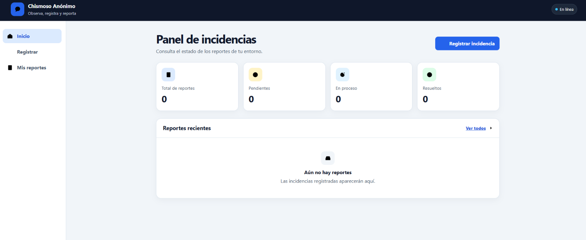
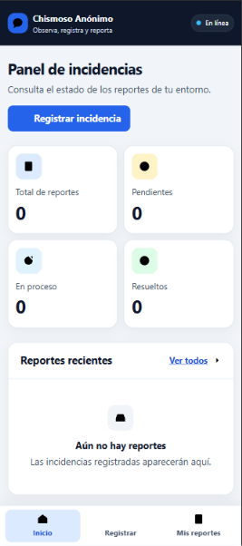
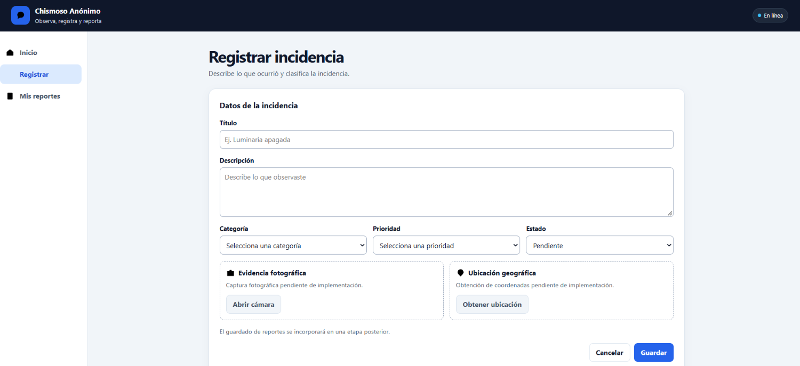
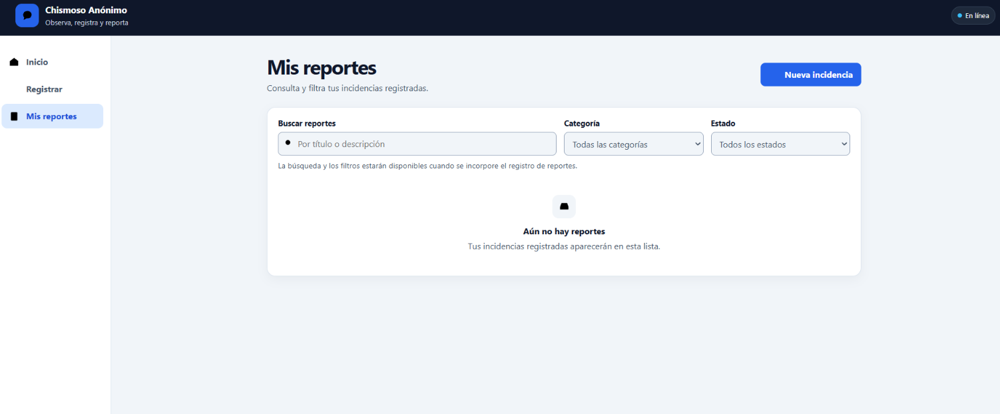
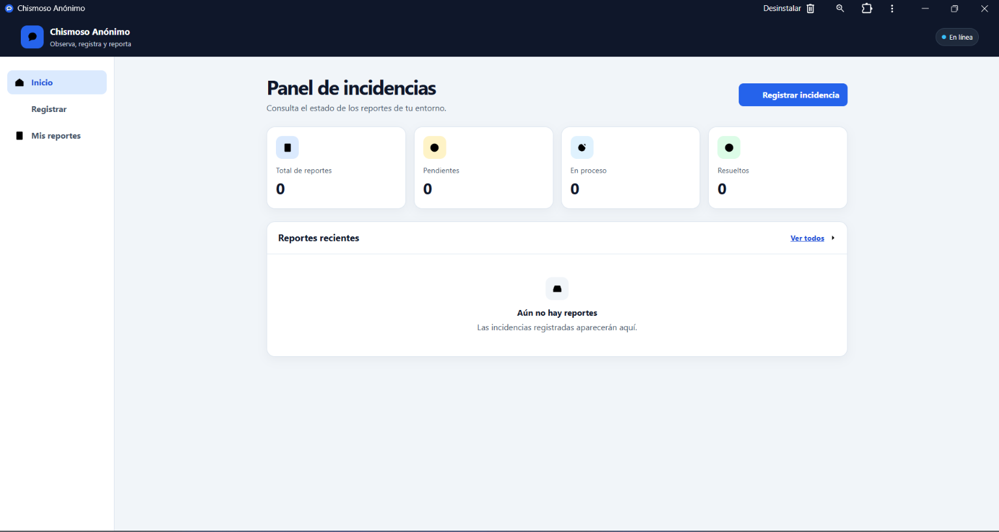
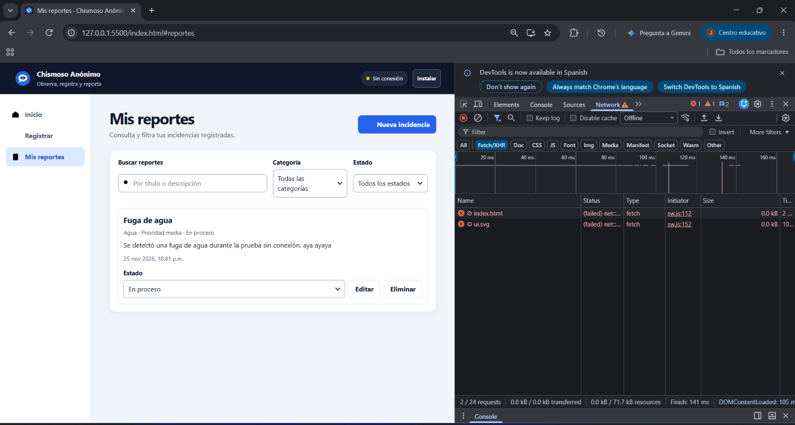

<p align="center">
  
</p>

# Chismoso Anónimo

**Observa, registra y reporta.**

Chismoso Anónimo es una aplicación web progresiva (PWA) académica para registrar y gestionar incidencias del entorno. Se puede instalar y, después de la primera carga en línea, permite trabajar sin conexión.

**[Abrir la aplicación publicada en Vercel (HTTPS)](https://chismoso-anonimo.vercel.app/)** · [Repositorio público en GitHub](https://github.com/Joss248/Chismoso-Anonimo)

## Caso de uso y objetivo

Una persona que detecta una luminaria averiada, una fuga de agua o un problema de limpieza puede registrar lo observado, asignar una prioridad y dar seguimiento a la incidencia. El objetivo es demostrar cómo una PWA puede mantener un registro local de incidencias y conservar su utilidad cuando se pierde la conexión.

## Funcionalidades principales

- **Inicio** presenta el total de reportes y los conteos de pendientes, en proceso y resueltos, además de las tres incidencias más recientes.
- **Registrar** permite capturar título, descripción, categoría, prioridad y estado, con fotografía y ubicación opcionales.
- **Mis reportes** permite buscar por título o descripción, filtrar por categoría y estado, editar, cambiar el estado y eliminar con confirmación.
- La interfaz se adapta a escritorio y móvil. El encabezado indica el estado de conexión informado por el navegador.

## Tecnologías utilizadas

| Tecnología | Uso |
| --- | --- |
| HTML5, CSS3 y JavaScript vanilla | Interfaz responsiva, componentes accesibles y renderizado del lado del cliente. |
| IndexedDB | Almacenamiento asíncrono de reportes y evidencia. |
| Service Worker y Cache Storage | Precarga, caché dinámica y acceso sin conexión. |
| Web App Manifest | Nombre, ámbito, modo independiente e iconos estándar y *maskable* para la instalación. |
| MediaDevices, Canvas y Geolocation | Captura fotográfica, generación de JPEG y obtención de coordenadas. |
| Git, GitHub y Vercel | Control de versiones, repositorio público y publicación HTTPS. |

## Arquitectura App Shell y CSR

La App Shell mantiene el encabezado y la navegación. En escritorio usa un menú lateral y en móvil, una barra inferior. El enrutador interpreta los fragmentos `#inicio`, `#registrar` y `#reportes` y renderiza la vista correspondiente en el área principal sin recargar el documento. Las vistas consultan el módulo de IndexedDB y los servicios encapsulan el acceso a las APIs del navegador.

## Estructura del proyecto

```text
Chismoso-Anonimo/
├── .gitignore
├── AGENTS.md
├── README.md
├── index.html
├── manifest.json
├── sw.js
├── assets/
│   └── icons/
│       ├── apple-touch-icon.png
│       ├── icon-192.png
│       ├── icon-512.png
│       ├── maskable-192.png
│       ├── maskable-512.png
│       └── ui.svg
├── css/
│   └── styles.css
├── docs/
│   └── screenshots/
│       ├── dashboard.png
│       ├── instalacion.png
│       ├── offline.png
│       ├── registro.png
│       ├── reportes.png
│       └── vista-movil.png
└── js/
    ├── app.js
    ├── router.js
    ├── data/
    │   └── reports-db.js
    ├── services/
    │   ├── camera.js
    │   ├── geolocation.js
    │   ├── install-app.js
    │   └── register-worker.js
    └── views/
        ├── components.js
        ├── dashboard.js
        ├── report-card.js
        ├── report-evidence.js
        ├── report-form.js
        ├── reports.js
        └── select-picker.js
```

## Ejecución local

1. Clona el repositorio y abre la carpeta en Visual Studio Code.
2. Con la extensión Live Server instalada, haz clic derecho en `index.html` y selecciona **Open with Live Server**.
3. Abre la dirección local que indique la extensión. Usa `localhost` o `127.0.0.1` para disponer de un contexto seguro.

Como alternativa, desde la raíz ejecuta `python -m http.server 5500 --bind 127.0.0.1` y abre `http://127.0.0.1:5500/`. Esta alternativa evita el cliente de recarga de Live Server, cuyo WebSocket puede mostrar un error al desconectarse.

## Instalación como PWA

Abre la aplicación en línea en un navegador compatible. Pulsa **Instalar** cuando aparezca el botón y confirma el diálogo. Si aparece **Cómo instalar**, consulta las opciones del menú del navegador. En Safari para iPhone o iPad, abre **Compartir** y elige **Añadir a pantalla de inicio** si está disponible. Al ejecutar la PWA en modo independiente, el control de instalación se oculta.

## Service Worker, caché y funcionamiento sin conexión

| Recurso | Estrategia |
| --- | --- |
| App Shell | Durante la instalación, el Service Worker valida y precarga HTML, CSS, módulos JavaScript, manifiesto e iconos. Si falla la precarga, se cancela la instalación del worker. |
| Navegación HTML | **Network First.** Intenta obtener la raíz o `index.html` por red. Si la red falla o el HTML pertenece a otra versión, usa el documento precargado. |
| Recursos estáticos | **Cache First.** Sirve los archivos de la versión activa desde su caché. Si falta un archivo, intenta recuperarlo cuando el servidor ofrece la misma versión. |
| Recursos adicionales | Las peticiones GET compatibles bajo `assets/` intentan la red y almacenan respuestas válidas en la caché dinámica para reutilizarlas sin conexión. |

Después de una primera carga correcta y una vez que el Service Worker controla la página, las vistas y la gestión de reportes funcionan sin conexión.

**Actualizaciones.** Al publicar cambios en la App Shell o su estrategia de caché, incrementa juntos `VERSION` en `sw.js` y el valor de `app-shell-version` en `index.html`. Actualiza la lista `shell` cuando agregues o retires recursos necesarios y publica el conjunto en una sola entrega. El nuevo worker espera a que se cierren las páginas controladas por el anterior. Al activarse, elimina las cachés obsoletas del proyecto en ese ámbito y conserva los reportes en IndexedDB.

## Persistencia local mediante IndexedDB

La base `ChismosoAnonimoDB` (versión 1) usa el almacén `reportes`, con un UUID como clave. Guarda los campos de la incidencia, las fechas de creación y actualización en formato ISO, la fotografía como `Blob` JPEG y la ubicación como latitud, longitud y precisión en metros. La fotografía y la ubicación admiten `null`.

Los reportes son independientes por navegador, perfil y origen (protocolo, host y puerto). La aplicación no los envía a autoridades, servidores externos ni otros usuarios.

## Cámara, geolocalización y permisos

- **Cámara.** `getUserMedia()` se invoca al pulsar **Abrir cámara**. Canvas reduce la captura y genera un JPEG para guardarlo localmente. La cámara libera sus pistas al cerrarla, al terminar la captura o al salir del formulario.
- **Geolocalización.** `getCurrentPosition()` se invoca al pulsar **Obtener ubicación**. La aplicación muestra las coordenadas y la precisión y permite actualizarlas o quitarlas.
- **Permisos.** Estas funciones requieren un contexto seguro (HTTPS o bucle local) y permiso del navegador. El formulario admite reportes sin evidencia cuando un permiso se deniega o el dispositivo no está disponible. El navegador puede recordar decisiones anteriores para el mismo origen. Para repetir la prueba de permisos, restablécelos desde la configuración del sitio.

## Credenciales de prueba

La aplicación **no requiere registro, inicio de sesión ni credenciales de prueba**. Las tres vistas están disponibles directamente al abrir la URL.

## Capturas de pantalla

Las capturas documentan distintas etapas del proyecto. Las imágenes del formulario y de Mis reportes corresponden a una etapa anterior a la integración de IndexedDB y la evidencia.

### Panel y vista móvil

<table>
  <tr>
    <td align="center"></td>
    <td align="center"></td>
  </tr>
  <tr>
    <td>Panel de estadísticas y reportes recientes.</td>
    <td>Diseño móvil con navegación inferior.</td>
  </tr>
</table>

### Formulario y consulta de reportes

<table>
  <tr>
    <td align="center"></td>
    <td align="center"></td>
  </tr>
  <tr>
    <td>Diseño inicial del formulario de incidencias.</td>
    <td>Diseño inicial de la consulta y sus filtros.</td>
  </tr>
</table>

### Aplicación instalada



La PWA se ejecuta en una ventana independiente.

### Funcionamiento sin conexión



La vista Mis reportes muestra una incidencia guardada localmente con la red desactivada en Chrome DevTools.

## Pruebas y verificaciones

**Automatizadas.** Las verificaciones incluyen sintaxis JavaScript y formato de los PNG. En Chrome automatizado se comprueban el manifiesto, la precarga y actualización de cachés, el diseño a 320, 375, 390, 768 y 1280 px, la carga del favicon y la navegación sin conexión. Las pruebas con IndexedDB real cubren persistencia tras recargar, alta, consulta, edición, cambios de estado, eliminación, filtros y estadísticas. Para las pruebas de evidencia se usan cámara virtual y coordenadas emuladas.

**Manuales.** La revisión de la entrega confirma la instalación, la activación del Service Worker, el uso de caché, la operación sin conexión y la persistencia. Para reproducirla:

1. Abre la app en línea y revisa **Application → Service Workers** y **Cache Storage** en Chrome DevTools. Confirma que la página esté controlada y que la App Shell esté precargada.
2. Registra una incidencia con evidencia si el dispositivo la permite. Activa **Offline**, recarga normalmente y navega entre las vistas. Comprueba la recuperación del reporte y su evidencia. Prueba crear, buscar, filtrar, editar, cambiar de estado y eliminar una incidencia.
3. Restablece la conexión. Para probar una actualización en un entorno local, cambia ambas versiones y espera la precarga. Cierra las ventanas de la aplicación, vuelve a abrirla en el mismo origen y verifica el cambio de caché y la conservación de los reportes.
4. Comprueba el menú de instalación y abre la aplicación en modo independiente. Revisa el formulario con teclado y pantalla táctil. Prueba también la concesión y denegación de permisos, y verifica que la cámara se libere al salir del formulario.

## Consideraciones y limitaciones

- El primer acceso requiere conexión. El modo offline empieza cuando termina la precarga y el Service Worker controla la página.
- La instalación y la pantalla de inicio dependen del navegador y del sistema. La cámara depende del hardware y de sus permisos. La ubicación puede fallar o exceder el tiempo de espera cuando el dispositivo no obtiene una posición.
- No hay backend, sincronización ni respaldo remoto. Borrar los datos del sitio puede eliminar los reportes locales.
